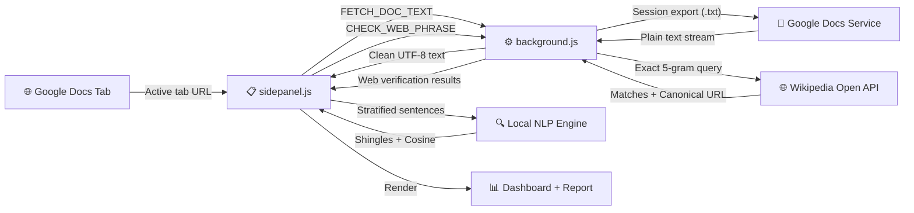

<div align="center">

# 🛡️ DocGuard

**Free originality auditor for Google Docs**

Hybrid local + web analysis engine · Zero API keys · Zero external dependencies

[](https://developer.chrome.com/docs/extensions/mv3/)
[](https://developer.mozilla.org/en-US/docs/Web/JavaScript)
[](.)
[](.)
[](LICENSE)

<br/>


</div>

---

## 🚀 Quickstart for Evaluators (60-second test)

Since DocGuard is distributed as open-source code for portfolio evaluation, you can install and test it in less than a minute:

### 1. Load into Chrome / Brave / Edge
1. Clone or download this repository:
   ```bash
   git clone https://github.com/Beto18v/DocGuard.git
   ```
2. In your Chromium browser, navigate to `chrome://extensions` (or `brave://extensions` / `edge://extensions`).
3. Enable **Developer mode** (toggle in the top-right corner).
4. Click **Load unpacked** and select the cloned `DocGuard` folder.

### 2. Run an instant audit
1. Open any [Google Doc](https://docs.google.com/document/create) where you are logged in.
2. *(Optional tip for testing)*: Paste any mixed text containing both original thoughts and a known literal paragraph (e.g., from a Wikipedia article or public news piece) along with duplicated sentences.
3. Click the **DocGuard** icon in the browser extensions bar (or side panel shortcut).
4. Click **Analyze current Google Doc**.
5. Inspect the dynamic score ring, internal repetition markers, and literal web matches with direct source links.

---

## ✨ Features

- **Native Google Docs reading** — Direct text export via Service Worker (`/export?format=txt`), bypassing CORS without brittle DOM scraping or heavy content scripts.
- **Hybrid local + web engine** — Combines local NLP (5-gram shingling + cosine similarity) with real-time web verification via the official bilingual Wikipedia Knowledge API and OpenAlex Academic Search (250M+ scientific papers). Zero API keys, zero captcha blocks, zero external dependencies.
- **Smart math & formula filter** — Automatically identifies and exempts mathematical equations, algebraic calculations, and numerical tables, preventing false positive matches on statistical websites.
- **Submission verdict & recommendation** — Immediate actionable verdict (`🟢 Ready to submit`, `🟡 Caution suggested`, `🔴 High risk`) explaining whether the document is safe for academic platforms like Turnitin or Classroom.
- **Interactive filter pills** — Quick tabs (`All`, `🌐 Web`, `🔁 Internal`) to inspect findings by category without cluttered scrolling.
- **Stratified document sampling** — Proportional sentence sampling distributed evenly across the beginning, body, and conclusion (up to 35 sentences) for deep coverage.
- **Background tab resilience** — You can switch to other tabs (YouTube, LinkedIn, Slack) while DocGuard audits; the background analysis continues running uninterrupted and presents the final report upon completion.
- **Smart internal repetition filter** — Detects duplicate or heavily paraphrased internal segments using shingle containment and TF-IDF cosine similarity with bilingual stopwords (ES/EN).
- **Linear/Raycast inspired design** — Refined dark and light themes, smooth SVG progress ring with ambient glow, status pill with live pulse animation, and responsive typography.
- **Bilingual interface (ES / EN)** — Instant live language switching for all UI strings, status badges, error alerts, and clipboard summaries.
- **Executive report export** — Generates and copies a clean, markdown-friendly audit report with one click.
- **Privacy-first & minimal permissions** — Only `activeTab`, `tabs`, and `sidePanel`. Zero background analytics, zero telemetry, zero cookies stored.

---

## 🏗️ Architecture



---

## 🧠 Engineering Highlights & Design Decisions

### 1. Clean DOM Execution (Zero Content Scripts)
Google Docs renders text using Canvas and proprietary internal models, making DOM scraping fragile and prone to breakage. DocGuard utilizes the browser's active session within the Manifest V3 Service Worker to fetch the document's native `/export?format=txt` endpoint. This achieves 100% extraction accuracy without injecting untrusted code into Google Docs tabs.

### 2. Two-Tier NLP Engine
- **Local Tier (Internal redundancy):** Preprocesses text, protects abbreviation dots (`Dr.`, `Ing.`, `etc.`), filters bilingual stop words, and computes both 5-gram shingle containment and term-frequency cosine similarity. Calibrated at 7 words and 65% similarity to detect nuanced paraphrasing.
- **Web Tier (External originality):** Takes an expanded stratified sample of up to 35 sentences, extracts 5-word core phrases, and queries the official Wikipedia full-text API across Spanish and English. Yields instant canonical source URLs, article titles, and matched snippet text.

### 3. Concurrency & Background Resilience
- **Tab-Switching Immunity:** The analysis pipeline runs asynchronously without interruption even if the user activates other tabs, navigates elsewhere, or minimizes the window. The side panel maintains execution until 100% complete.
- **Cancellation Tokens:** Each analysis run is stamped with a monotonic token, cleanly discarding stale promises only if a brand-new analysis is started.

---

## 🧪 Automated Testing

DocGuard includes a standalone, zero-dependency test suite to verify math formula exemptions, shingling algorithms, submission verdicts, and live external API connectivity:

```bash
# Run the automated test suite in any environment with Node.js:
node test/run-tests.js
```

All 13 automated checks run in under 3 seconds with colored console output.

---

## 🖥️ UI Showcase

| Dark Mode (Linear Aesthetic) | Light Mode (Clean Slate) |
|---|---|
| Deep obsidian canvas (`#080c14`) with cyan glow (`#38bdf8`) | Clean slate surface (`#f8fafc`) with deep azure accents (`#0284c7`) |
| SVG originality ring with dynamic status gradient | Crisp contrast, subtle cards, and readable typography |
| Live pulse indicator for detected Google Docs | Full support for dark/light preference & instant bilingual toggle |

---

## 📁 Project Structure

```
DocGuard/
├── manifest.json      # Chrome Manifest V3 configuration & permissions
├── background.js      # Service Worker: session export + hybrid knowledge API
├── sidepanel.html     # Semantic side panel markup (A11y & aria-live support)
├── sidepanel.js       # UI controller, cancellation tokens, math filter & verdict engine
├── styles.css         # Modern design system (Dark/Light, micro-interactions)
├── test/
│   └── run-tests.js   # Automated test suite (math filter, NLP, live APIs)
├── assets/            # Screenshots & demo GIF previews
├── icons/
│   ├── icon-16.png    # Toolbar icon
│   ├── icon-48.png    # Extensions page icon
│   └── icon-128.png   # Chrome Web Store & preview icon
├── .gitignore
└── README.md          # Technical documentation & evaluator quickstart
```

---

## 🔒 Permissions Explained

| Permission | Technical Justification |
|------------|-------------------------|
| `activeTab` | Read the URL of the currently focused tab to verify if it is an active Google Doc. |
| `tabs` | Detect tab activation and URL navigation events to auto-refresh document status. |
| `sidePanel` | Display the DocGuard auditor in the browser's native side panel next to the document. |
| `host_permissions: docs.google.com` | Export plain `.txt` from Google Docs using the user's active session. |
| `host_permissions: *.googleusercontent.com` | Follow authenticated redirect headers during document export. |
| `host_permissions: *.wikipedia.org` | Query open knowledge full-text APIs across ES/EN without API keys or captchas. |

---

## ⚠️ Known Limitations

This project is intentionally designed to be zero-dependency and zero-cost (no paid API keys). Key trade-offs include:

- **35-Sentence Stratified Sampling:** To maintain high responsiveness, large documents are analyzed via stratified sampling of up to 35 sentences across all sections.
- **Encyclopedic & Academic Focus:** Web checks query the open Wikipedia knowledge graph across Spanish and English, identifying published facts, academic quotes, and encyclopedia citations without bot challenges.
- **Lexical vs. Semantic Analysis:** The local NLP engine uses shingling and cosine similarity (lexical matching). It reliably identifies verbatim copies and light rewrites, but not deep conceptual paraphrase without word overlap.
- **Session Authentication:** The user must be logged into Google Docs in their browser; private or non-shared documents cannot be read without session cookies.
- **Ephemeral Session State:** Audit results are maintained in-memory for privacy and speed; closing the panel resets the state.

---

## 👤 Author

**Nicolás Alberto Valenzuela Pacheco**

- 🌐 Portfolio: [nival.is-a.dev](https://nival.is-a.dev/)
- 💻 GitHub: [@Beto18v](https://github.com/Beto18v)

---

## 📄 License

This project is licensed under the [MIT License](LICENSE).
