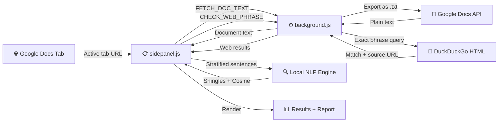

<div align="center">

# 🛡️ DocGuard

**Free originality auditor for Google Docs**

Hybrid local + web analysis engine · Zero API keys · Zero dependencies

[](https://developer.chrome.com/docs/extensions/mv3/)
[](https://developer.mozilla.org/en-US/docs/Web/JavaScript)
[](.)
[](.)
[](LICENSE)

<br/>


</div>

---

## ✨ Features

- **Native Google Docs reading** — Exports document text directly via the service worker, bypassing CORS restrictions without content scripts.
- **Hybrid local + web engine** — Combines local NLP analysis (5-gram shingling + cosine similarity) with real-time web verification via DuckDuckGo HTML search. No API keys, no paid services, no external dependencies.
- **Stratified document sampling** — Analyzes up to 20 sentences distributed proportionally across beginning, body, and conclusion for comprehensive coverage.
- **Smart internal repetition filter** — Detects internal plagiarism using shingle containment + cosine similarity, filtering stopwords in both Spanish and English. Only flags sentences ≥ 9 words to avoid false positives on titles, headers, and proper nouns.
- **Dark / Light theme** — Modern, high-contrast UI inspired by Linear and Vercel. Persists preference in `localStorage` and respects `prefers-color-scheme`.
- **Bilingual interface (ES / EN)** — Complete i18n system with instant language switching. All UI text, status messages, error states, and exported reports adapt to the selected language.
- **One-click report export** — Copy a formatted executive summary to the clipboard with date, document title, originality index, and all findings.
- **Minimal permissions** — Only `activeTab`, `tabs`, and `sidePanel`. No `storage`, no background persistence, no analytics.

---

## 🏗️ Architecture



---

## 📦 Installation

### Chrome / Brave / Edge (3 steps)

1. **Download** — Clone or download this repository:
   ```bash
   git clone https://github.com/Beto18v/DocGuard.git
   ```

2. **Load the extension** —
   - Open `chrome://extensions` (or `brave://extensions` / `edge://extensions`)
   - Enable **Developer mode** (toggle in the top-right corner)
   - Click **Load unpacked** and select the `DocGuard` folder

3. **Use it** —
   - Open any Google Doc in your browser
   - Click the **DocGuard** icon in the toolbar (or pin it)
   - The side panel opens automatically — hit **Analyze** and review the results

> [!NOTE]
> You must be signed in to your Google account for the extension to export document text.

---

## 🖥️ UI Preview

| Dark Mode | Light Mode |
|-----------|------------|
| Deep navy canvas `#090d16` with cyan accents `#38bdf8` | Clean white surface `#f8fafc` with blue accents `#0284c7` |
| Circular SVG progress ring for originality score | Subtle shadows and soft borders |
| Bilingual toggle (ES/EN) + theme toggle (☀️/🌙) in top bar | Same controls, light palette |

---

## 📁 Project Structure

```
DocGuard/
├── manifest.json      # Chrome Manifest V3 configuration
├── background.js      # Service worker (doc export + web search)
├── sidepanel.html     # Side panel markup
├── sidepanel.js       # UI controller, i18n, NLP engine
├── styles.css         # Design system (dark/light themes)
├── icons/
│   ├── icon-16.png    # Toolbar icon
│   ├── icon-48.png    # Extensions page icon
│   └── icon-128.png   # Chrome Web Store icon
├── .gitignore
└── README.md
```

---

## 🔒 Permissions Explained

| Permission | Reason |
|------------|--------|
| `activeTab` | Read the URL of the currently active tab to detect Google Docs |
| `tabs` | Listen for tab changes to auto-detect document switches |
| `sidePanel` | Open the DocGuard analysis panel alongside the page |
| `host_permissions: docs.google.com` | Export document text as plain `.txt` |
| `host_permissions: *.googleusercontent.com` | Handle Google Docs redirects |
| `host_permissions: html.duckduckgo.com` | Web verification via DuckDuckGo HTML search |

---

## 👤 Author

**Nicolás Alberto Valenzuela Pacheco**

- 🌐 Portfolio: [nival.is-a.dev](https://nival.is-a.dev/)
- 💻 GitHub: [@Beto18v](https://github.com/Beto18v)

---

## 📄 License

This project is licensed under the [MIT License](LICENSE).
